# homi — Redfin-to-Viral Real Estate Feed, 3D Walkthrough & Amazon × YouTube Open House Rank

> **Source-backed 94404 work:** open `/?zip=94404` in the original swipe feed for six eligible single-family houses in descending asking-price order, 147 unretouched source images, and one navigable floor-plan schematic. The requested ten-house selection remains incomplete; five current houses need usable plans. **Zero generated walkthrough videos or photorealistic 3D conversions are verified.** Open a home’s **Plan + research** action for the model, photos, floor plan and verification without leaving the feed. A direct entry is `/?zip=94404&home=redfin-1062292&view=model`. See [verification evidence and setup](docs/94404-verification.md). The hackathon feed below is a demo using stock/generated imagery.

Built for the **Hack the Feed: Creator Tools Hackathon** (Oriane × GMI Cloud × Lovable × Compound).

**Generated walkthrough correction:** the 94404 target is a continuous, newly generated camera video within this original feed. The current photo sequence and schematic do not meet that target. Live generation uses the direct Gemini API with an explicitly designated project credential; no generated 94404 video is accepted yet. See [the pilot and credential setup](docs/grounded-video-pilot.md). Existing cached hackathon media retains its original provenance and can be browsed without a key.

**homi** preserves a TikTok / YouTube-style real estate feed with **4-way swipe gestures**, larger walkthrough playback and an in-depth research view. The older Bay Area hackathon demo includes cached generated tours, parallax effects and sample social data. Source-backed 94404 homes keep their own photos and property data; a reviewed generated video is shown only after appearance, layout and motion checks pass.

---

## High-Level System Architecture

```mermaid
flowchart LR
    subgraph Ingest["1 · Redfin & Zip Code Ingest"]
        A["Bay Area Zip Selector<br/>(94301, 94115, 94941, 94022)<br/>or Redfin Listing URL"] --> B["Spatial Room Graph<br/>(Exterior → Living → Kitchen → Primary → Pool)"]
    end

    subgraph Oriane["2 · Oriane Viral Intelligence"]
        B --> C["POST /rest/contents/search<br/>(9.85B Niche Views Analyzed)"]
        C --> D["Outlier Hooks & Retention Signals<br/>(21,393% Outlier Ratio · 4.71% Eng)"]
    end

    subgraph Gemini["3 · Direct Gemini API"]
        B & D --> E["Gemini Flash Director<br/>(Source-grounded Shot Planning)"]
        E --> F["Image-guided Video Generation<br/>(Continuous Camera Movement)"]
        E --> G["Gemini Speech Generation<br/>(Creator Voiceover)"]
        F & G --> H["Source, Layout & Motion Review<br/>Accepted Video Clips"]
    end

    subgraph Experience["4 · homi 3-Stage Studio + Amazon × YouTube Rank"]
        H --> I["Stage 1: 4-Way Swipe TikTok (9:16) /<br/>YouTube (16:9) Zip Feed"]
        I --> J["Stage 2: Click House → Full-Screen<br/>Automatic Walkthrough"]
        J --> K["Stage 3: On-Demand 3D Deep Explore<br/>(Parallax + Hotspots + 2.5D Radar)"]
        I & J & K --> M["Amazon ★ × YouTube 👍 Live Open House<br/>(Real-Time Thumbs Up/Down, Comments & Live Video/Photo Upload)"]
        M --> L["Compound Distribution<br/>(#HackTheFeed Viral Loop)"]
    end
```



---

## Feed and Demo Features

1. **Stage 1 — Front-Page TikTok (`9:16`) / YouTube (`16:9`) Zip Code Feed + 4-Way Swipe**:
   - Filter by Bay Area Zip Code (`All Bay Area`, `94301 · Palo Alto`, `94115 · San Francisco`, `94941 · Mill Valley`, `94022 · Los Altos Hills`) or paste any Redfin URL.
   - Cached hackathon homes include 34–43 second generated room-to-room videos with AI voiceover. Real 94404 homes show original references while their generated-video review is pending.
   - **4-Way Swipe / Drag / Keyboard Gestures**:
     - **Swipe Left (`←`) / Right (`→`)**: Sweep between homes in the active Zip Code.
     - **Swipe Up (`↑`)**: Save home to **`💛 Saved`** collection and cast a real-time 👍 upvote.
     - **Swipe Down (`↓`)**: Hide / don't show home and advance to the next listing.
2. **Stage 2 — Click Any Home → Automatic Larger Full-Screen Walkthrough**:
   - Hands-free continuous room-to-room playback (`Courtyard → Great Room → Chef's Kitchen → Primary Sanctuary → Zero-Edge Pool`) with warm AI voiceover and subtle bottom-corner property specs.
3. **Stage 3 — On-Demand 3D Deep Explore Mode**:
   - Switch to **3D Deep Explore Mode** anytime for interactive 3D mouse-look parallax, glowing architectural hotspots (`✦`), a 2.5D floorplan radar, frame-by-frame scrubbing, and Oriane viral intelligence insights.
4. **Amazon × YouTube Real-Time Open House Ranking & Crowd Verification**:
   - Viewers at the Open House can give real-time **👍 Thumbs Up / 👎 Thumbs Down**, rate verification attributes (*Matches AI Walkthrough 4.9★*, *Natural Light & Warmth 5.0★*, *Floorplan Flow 4.9★*), post live comments, and **upload real-time Open House photos or videos** to dynamically rank homes in the feed.

---

## Quick Start (Local Server)

```bash
# 1. Create environment and install dependencies
uv venv --python 3.11 .venv
uv pip install --python .venv/bin/python -r requirements.txt

# 2. Optional: configure explicitly designated PROJECT credentials for live generation.
# Cached browsing and /94404 need no API key. Generic personal key variables are ignored.
export HOMI_GEMINI_API_KEY="your_project_gemini_api_key"
export HOMI_ORIANE_API_KEY="your_project_oriane_api_key"

# 3. Start homi server on http://localhost:8000
.venv/bin/uvicorn server:app --host 0.0.0.0 --port 8000
```

- **Main App**: `http://localhost:8000`
- **Pitch & Architecture Slide Deck**: `http://localhost:8000/static/pitch_deck.html`

The Gemini key stays on the server. Use only a project credential; generic personal key variables are not discovered. For the source-grounded CLI, an explicitly designated ignored `api_key.md` may be supplied with `--credential-file api_key.md`. Model access and video billing are determined by the Gemini API project, independently of a chat application's model menu.

| Task | Model |
| --- | --- |
| Shot planning and text | `gemini-3.8-flash` |
| New image-guided camera video | `gemini-omni-1.2-flash` |
| Optional voiceover | `gemini-3.8-flash-tts` |

These paths use no Argon model. The generated footage still needs visual review; a floor-plan reference and matching endpoints do not establish calibrated 3D geometry or faithful intermediate views.
