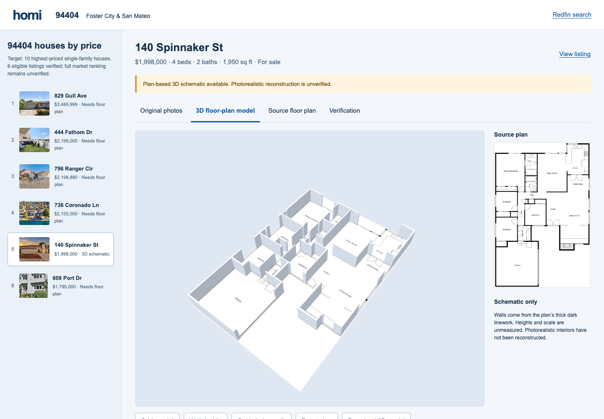

# 94404 conversion evidence

The full request is **incomplete**. The requested result is a newly generated continuous walkthrough video inside the original swipe feed, supported by photos, floor plans and 3D research. The current photo sequences and schematic do not satisfy it. Six eligible houses have an original-photo viewer; four of the ten requested selection slots remain unfilled. One has a navigable schematic derived from a listing floor plan. None has a verified photorealistic 3D reconstruction or accepted generated walkthrough video. A [finite GMI pilot and review workflow](grounded-video-pilot.md) are prepared for 140 Spinnaker.

## Selection and sources

The requested selection is **ten highest-priced single-family houses in 94404**. The supported set has six active/coming-soon houses, sorted by asking price descending. The selection and market-wide ranking remain incomplete. Condos, townhomes, sold and pending properties are excluded. Prices and availability can change.

A live [MLSListings 94404 search](https://www.mlslistings.com/) returned 31 listings, including four active single-family residences: Fathom, Ranger, Coronado and Spinnaker. Redfin adds the Gull for-sale-by-owner listing and Port coming-soon listing. The exact live search URL and coverage notes are saved in `data/redfin_94404_sources.json`. Older search snapshots included sold or pending houses; those were excluded after refreshed listing checks. Puffin had conflicting cached status and remains excluded pending confirmation.

Direct browser and HTTP collection encountered Redfin’s rate-limit page. Public indexed listing pages supplied the retrieved image URLs. No access challenge was bypassed. The 147 retrieved images are the available evidence set, not a guarantee that every listing photo was retrieved.

| Price order | House | Asking price | Retrieved images | 3D status |
| ---: | --- | ---: | ---: | --- |
| 1 | 829 Gull Ave | $3,489,999 | 1 | Needs floor plan and interior photos |
| 2 | 444 Fathom Dr | $2,199,000 | 24 | Needs floor plan |
| 3 | 796 Ranger Cir | $2,198,880 | 25 | Needs floor plan |
| 4 | 736 Coronado Ln | $2,155,000 | 49 | Needs floor plan |
| 5 | 140 Spinnaker St | $1,998,000 | 44 | Schematic floor-plan extrusion |
| 6 | 608 Port Dr (coming soon) | $1,795,000 | 4 | Needs floor plan |

`data/redfin_94404_sources.json` records exact listing and image URLs. `data/94404/downloads.json` records acquisition hashes. Originals are cached locally and excluded from Git; `scripts/build_94404.py --download` retrieves them for a fresh checkout. A changed source must be reviewed before accepting a new hash baseline.

## What was verified

- All 147 selected images pass SHA-256 comparison between acquired originals and bytes served by the application. Modified files are rejected with HTTP 409; missing files return 404. No generated substitute is served.
- The photo viewer uses complete images with preserved aspect ratio. It applies no retouching, geometric warping, image generation or interpolated camera travel.
- One actual browser screenshot of Spinnaker photo `redfin-1062292-010.jpg`, displayed at 900 × 600, had SSIM 0.991444 against the source resized to that display size. The small difference includes browser versus Pillow resampling and subpixel placement. This is a single display-fidelity check, **not** a score for 3D reconstruction or unseen views.
- The original Spinnaker floor plan is preserved. Its inspected crop is `[378, 26, 902, 820]` in the 1280 × 960 source image. Thick dark linework is extracted, with isolated text and thin arcs removed. The source SHA-256 is recorded in the model.
- The 117 exported wall boxes reproduce the extracted mask exactly. The actual browser-generated glTF download was parsed and its node footprints were independently rasterized and compared with the model mask. This checks the export pipeline; it does not validate the extraction against the real building.
- The guided route completed from the living area through the foyer/hall opening and family area to the kitchen. Movement checks the extracted walls and manually inspected exterior footprint, in small steps to prevent tunneling.
- Browser rendering and navigation were checked at desktop size and 390 px mobile width, with no horizontal document overflow or page errors.
- Thirteen automated checks cover offline browsing, safe imports, explicit partial status, original-byte integrity, missing assets and tampered originals. Python compilation and JavaScript syntax checks pass.



## Limits and completion criteria

The model uses source-image coordinates. Neither horizontal dimensions nor wall/ceiling heights are calibrated. The floor plan’s own measurement disclaimer still applies. Thin windows, door leaves, attached fixtures, stairs, elevations and ceilings are not fully reconstructed. Dark attached fixtures may be extruded as walls. Photos are presented as references; they are not projected onto invented surfaces.

The photo sequence follows gallery order and makes no room-adjacency claim. Listing staging, finishes and camera placement have not been independently verified. The old hackathon feed remains a labeled demo with generated imagery; it is separate from `/94404`.

To finish the request, first verify four additional eligible listings (or supply an authoritative complete selection). Obtain usable plans for all floors of the five current houses without plans and any added houses, missing interior views, dimension/height calibration and camera-to-room correspondences. Then reconstruct and review doors, windows, materials and geometry against calibrated reference renders, and inspect unseen views. A full conversion must remain incomplete until those checks pass. No personal API key or paid generation service was used for this work.

## Reproduce

```bash
uv venv --python 3.11 .venv
uv pip install --python .venv/bin/python -r requirements.txt pytest
.venv/bin/python scripts/build_94404.py --download
.venv/bin/uvicorn server:app --host 127.0.0.1 --port 8044
# In another terminal:
.venv/bin/python scripts/verify_94404.py
.venv/bin/python -m pytest -q
```

Open `http://127.0.0.1:8044/94404#redfin-1062292`, select **3D floor-plan model**, then **Guided plan walk**. The model can be downloaded as glTF. Floor-plan and Verification tabs expose the source and assumptions.


## Feed integration and 3D visibility

The original Instagram/TikTok-style reel, card grid, ZIP filters, aspect switch and swipe/save/hide interactions remain the main experience at `/?zip=94404`. Source homes use their own unretouched photo sequences; no unrelated demo video, ratings, live comments or crowd counts are substituted. The generated-video demo ZIPs remain available.

The feed’s **3D walkthrough** action opens Spinnaker directly in a same-page research overlay. Its Photos, 3D model, Floor plan and Verification tabs support deeper inspection. **Back to feed** and Escape inside the model close research, unload its renderer, and retain the selected home/filter/save state. Mobile controls appear above the model.

The earlier `/94404#redfin-1062292` URL encoded only a home ID and therefore opened Photos. Explicit `?view=model` routing now renders the model immediately; unknown/missing geometry opens the evidence panel. The standalone route is retained for direct inspection, while the primary deep entry preserves the feed behind it:

`/?zip=94404&home=redfin-1062292&view=model`

Run the real Chromium interaction check with agent-browser installed:

```bash
.venv/bin/python scripts/verify_feed_ui.py
```

It checks feed media identity, direct 3D opening, guided walking, iframe Escape and cleanup, feed-state preservation, source saves, empty filters, switching to demo ZIPs, mobile visibility and absence of paid/social requests or page errors.
